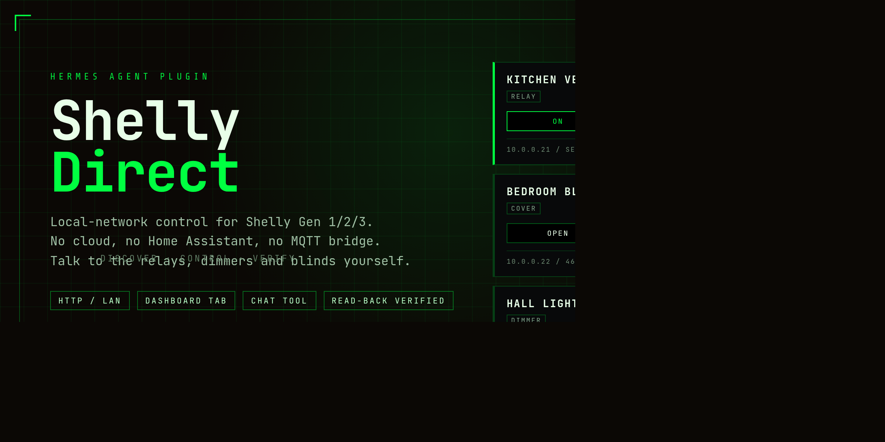
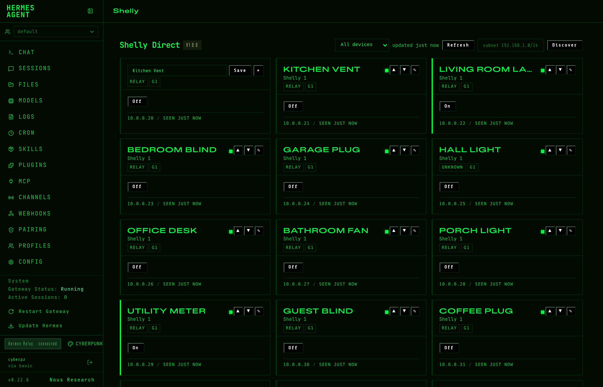
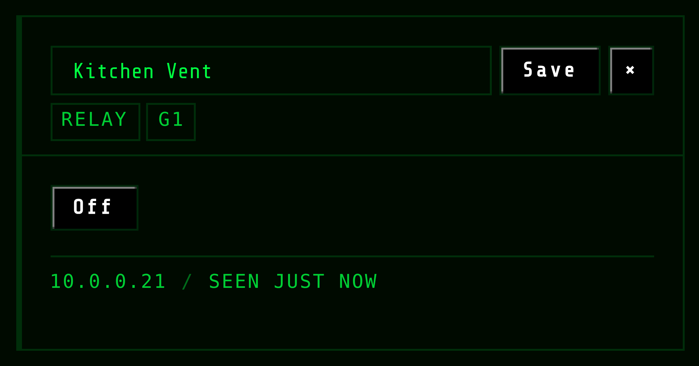

# Shelly Direct — Hermes Agent plugin



Control your **Shelly smart-home devices directly on the LAN** from Hermes Agent —
relays, dimmers, RGB, roller shutters, power meters, sensors.
**No Home Assistant. No MQTT broker. No cloud account.** Just your Wi-Fi.

Built for the [Hermes Plugin Hackathon](https://hermes-agent.nousresearch.com) — but meant to outlive it.

## Why

Plenty of smart-home bridges exist, but they all want you to stand up a server
first. Shelly devices run a full HTTP API *on the device itself* — this plugin
speaks it natively for **all three generations** (Gen1 ESP8266-era REST,
Gen2/Gen3 RPC) and gets out of the way.

- 💡 **Zero-config discovery** — one UDP broadcast finds every Shelly on the
  segment; a TCP-gated CIDR sweep covers IoT VLANs where broadcast is blocked
- 🧬 **Auto gen-detection** — one probe tells Gen1 from Gen2/3, per device
- ✅ **Verify-after-write** — every command is read back from the device;
  `verified: false` means the device did *not* confirm, and Hermes says so
- 🔋 **Real state, not guessed state** — live power (W/kWh), temperature,
  humidity, shutter position
- 🖥️ **Dashboard tab** — a control minidash inside the Hermes web dashboard
- 🔒 **LAN-only** — the plugin talks to your devices and nothing else (see
  [Security & disclosure](#security--disclosure))

## Install

```bash
hermes plugins install cyberpz/hermes-shelly-direct
hermes plugins enable shelly-direct
```

Once the catalog entry is merged, `hermes plugins install shelly-direct` works too.

Then in any Hermes chat:

> discover my Shelly devices

If your access point blocks UDP broadcast (common on IoT VLANs), the agent
will find out and you can sweep explicitly:

> scan 192.168.1.0/24 for Shelly devices

## What Hermes can do with it

| You say | Tool call |
|---|---|
| "turn on the coffee machine" | `{"action":"on","device":"coffee"}` |
| "dim the desk to 40%" | `{"action":"set","device":"desk","brightness":40}` |
| "close the bedroom shutters" | `{"action":"cover","device":"bedroom","op":"close"}` |
| "what's the washing machine drawing?" | `{"action":"meter","device":"washer"}` |
| "how warm is the attic?" | `{"action":"sensor","device":"attic"}` |
| "call the hallway lamp 'Hall Light'" | `{"action":"rename","device":"hallway","name":"Hall Light"}` |
| "find my devices" | `{"action":"discover"}` (optional `"subnet":"…/24"`) |

Full action vocabulary: `discover`, `list`, `status`, `on`, `off`, `toggle`,
`set` (brightness/rgb/white), `cover` (op/position), `meter`, `sensor`, `rename`.
Devices are addressed by name, alias (substring ok), id, MAC or IP.

A bundled skill teaches the agent the vocabulary and the failure modes
(battery devices sleep, ambiguous names, protected devices).

## CLI

```bash
hermes shelly discover            # scan + inventory
hermes shelly list                # known devices
hermes shelly status "office"     # live state of one device
```

## Dashboard tab

Installing the plugin adds a **Shelly** tab to the Hermes web dashboard: a
device grid with online state, relay toggles, dimmer sliders, shutter
controls and live power readouts, backed by a REST API under
`/api/plugins/shelly-direct/`.



What the tab does beyond clicking buttons:

- **Rename / map devices** — pencil on any card; the alias sticks and wins over
  the device's own name (it is what the chat tool resolves too)
- **Manual ordering** — ▲▼ on every card, persisted per-install in `order.json`
- **Filter** — All / Mapped / Unmapped, because a fresh discovery of 40+ devices
  is mostly unnamed hardware
- **Fast lane for covers** — anything in motion, or commanded in the last 20s,
  is polled every 3s (plus a 1.2s settle read), so *Stop* lands in the UI in
  ~1.5s instead of waiting for the 10s tick. Gen1 covers never report
  "opening", which is exactly why the time window exists
- **Self-healing online state** — a real status read is the source of truth; a
  device missed by one sweep heals itself instead of staying grey forever



## Configuration

All optional — defaults work out of the box.

| Setting | Default | Meaning |
|---|---|---|
| `extra_hosts` | `[]` | IPs/CIDRs to probe beyond the local segment (routed/VLAN setups) |
| `timeout_ms` | `3000` | per-device HTTP timeout |
| `verify_writes` | `true` | read back state after every command, retry once on mismatch |
| `auth_user` | `""` | digest-auth user for password-protected devices (`admin`) |
| `auth_password` | — | digest-auth password, stored as a Hermes secret |

## How it works

```
discovery   UDP :10100 broadcast (+ directed broadcasts, + CIDR sweep fallback)
probe       GET /shelly → gen, model, mac, id          (one request, all gens)
Gen1        GET /status · /relay/0?turn=on · /roller/0?go=close
Gen2/3      POST /rpc/Switch.Set · Cover.GoToPosition · Light.Set
inventory   MAC-keyed JSON in the Hermes plugin-data dir (IPs drift, MACs don't)
```

## Security & disclosure

- **Network scope:** HTTP to Shelly devices on your LAN + one UDP broadcast
  probe on port 10100. **No third-party endpoints, no telemetry, no cloud.**
- **Secrets:** the optional device password is stored via the Hermes secret
  store (`get_secret`), never in config files.
- **Writes:** only to devices you address; every write is verified by reading
  the device back.
- **Discovery sweep:** the CIDR sweep is opt-in (explicit `subnet` or
  `extra_hosts`), TCP-gated, and capped at /22 per entry. A malformed CIDR is
  rejected before any traffic leaves the box, and a sweep that probed nothing
  never demotes your inventory.

## Development

```bash
python3 -m pytest                  # 33 tests: stateful Gen1 + Gen3 stubs, no mocks
hermes plugins validate . --install-deps
hermes plugins doctor .
```

Live-tested against a 47-device fleet (Gen1/2/3, relays, dimmers, covers,
power meters): 20 concurrent toggles, restart survival, blocked-UDP networks,
invalid input fuzzing. Bugs found that way are in the git log with the fix.

## Limitations (honest list)

- Battery (Gen2/3) devices sleep — `status` fails until they wake; the plugin
  says so instead of pretending.
- BLE-only gateways (Gen2/3 BLE) are bridges, not endpoints: control the
  *wired* device behind them.
- CoIoT/MQTT event push is out of scope by design: this plugin polls state
  on demand and keeps no daemons.

## License

MIT © Cyberpz
